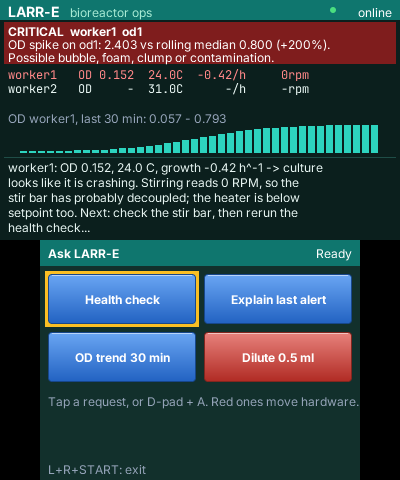
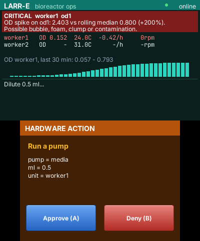

# LARR-E for Nintendo 3DS

A native 3DS app built with [PocketJS](https://github.com/pocket-nexus/pocketjs) (Solid + QuickJS).
- **Top screen:** the live bioreactor dashboard.
- **Bottom screen:** requests you can tap.
- **Hardware approval:** when the agent wants to run a pump, the bottom screen becomes an approval
  gate. Press **Ⓐ to approve** or **Ⓑ to deny**.

| Asking for a health check | The approval gate |
|---|---|
|  |  |

*These are frames from the PocketJS wasm renderer (`bun scripts/sim.ts`), not photos of hardware.*

## How it connects

```
3DS: LARR-E.3dsx ◄── TCP 8741, paired key ── bun bridge/serve.ts ── HTTP ──► larr-e api ──► MQTT / SQLite / Claude
     (this app)       (PocketJS offload)       (on your computer)            (api_server.py)
```

A PocketJS app on the 3DS has no general HTTP client. It sends small named requests (**offload**)
to a provider process on your computer. The provider here is `bridge/`, and it relays four
allowlisted methods to the LARR-E API:

| Method | What it does |
|---|---|
| `larre.snapshot` | Live status, the latest alert, any pending approval, and the OD sparkline. Polled every second |
| `larre.preset` | Starts a canned agent request (Health check, Explain last alert, OD trend, Dilute 0.5 ml) |
| `larre.job` | Polls a running request. Answers take longer than offload's 9-second limit |
| `larre.decide` | Approves or denies a pending hardware action |

Every reply stays under PocketJS's 2,500-character budget. Replies are ASCII only, since the 3DS
draws baked glyphs ("°C" becomes "C", "→" becomes "->"), and are wrapped into lines before
sending.

## One-time setup (Linux; tested on Fedora)

Upstream documents a macOS build. The same toolchains build on Linux once
`tools/docker` translates Docker commands to Podman, so you don't need a Mac.

```bash
# Rust: the 3DS core needs the nightly pinned in runtime/hosts/3ds/core/rust-toolchain.toml
curl https://sh.rustup.rs -sSf | sh
rustup toolchain install nightly-2026-07-02 --profile minimal --component rust-src
rustup target add wasm32-unknown-unknown          # only for the simulator

# Bun (PocketJS's build tools are Bun scripts)
curl -fsSL https://bun.sh/install | bash

# The pinned devkitARM image (C toolchain, libctru, citro3d, 3dsxtool)
podman pull docker.io/devkitpro/devkitarm@sha256:116afba8df8453961de2936ffab20dd441edf4d682856c1ec8b0e53d7ed0bbf5

# The PocketJS runtime, pinned to the commit Pocket Doc runs on real 3DS hardware
cd ~/larr-e
git submodule update --init pocket3ds/runtime
cd pocket3ds
bun install --cwd runtime --frozen-lockfile
bun run setup

# QuickJS sources arrive with the PSP host's cargo dependencies (only quickjs-rs is needed)
(cd runtime/hosts/psp && cargo fetch)
```

**macOS / hackintosh instead:** install Docker Desktop and skip `tools/docker`. Everything else is
the same.

## Build

```bash
cd ~/larr-e/pocket3ds
PATH="$PWD/tools:$PATH" bun run 3ds        # dist/larr-e-main.3dsx (+ .pocket)
bun run 3ds --pocket-only                  # just the app package; no Rust or container needed
bun run check && bun run test              # typecheck + bridge tests
```

## Try it without a 3DS

```bash
bun runtime/tools/wasm.ts                  # build the wasm renderer once
# in another terminal: LARRE_DRY_RUN=1 LARRE_API_TOKEN=devtoken larr-e api
LARRE_API_TOKEN=devtoken bun scripts/sim.ts
```

This runs the compiled app with scripted taps and button presses, through the real bridge
methods, and writes both screens to `dist/qa/*.png`. The script approves a dose, so it refuses to
run unless the API is in dry-run mode.

## Install on the 3DS

1. On the 3DS, open **ftpd** from the Homebrew Launcher. Note the IP it shows; it listens on port 5000.
2. On your computer:
   ```bash
   python3 scripts/deploy.py <3ds-ip>
   ```
   This creates `.local/pair.key` (once). It uploads the key to
   `sdmc:/pocketjs/offload/e8ecf4734ee87acb.key` and the app to `sdmc:/3ds/larr-e.3dsx`, then reads
   both back to verify them.
3. Close ftpd. The app and ftpd can't share the network.

## Run

On the computer that runs LARR-E (the leader, so the agent can read the database):

```bash
export LARRE_API_TOKEN=pick-a-long-random-string
larr-e listen                                   # terminal 1: anomaly detection
larr-e api                                      # terminal 2: HTTP API on :8787
cd pocket3ds && bun run bridge <3ds-ip>         # terminal 3: pairs with the 3DS
```

Start **LARR-E** from the Homebrew Launcher. The top-right dot turns green when the bridge is
connected.

| Control | Action |
|---|---|
| Tap a button, or D-pad + Ⓐ | Run that request. **Red buttons move hardware** and always ask first |
| Ⓐ / Ⓑ on the approval screen | Approve / deny the exact pump or setpoint change shown |
| L + R + START | Back to the Homebrew Launcher |

Approvals from the 3DS, the web dashboard and the CLI all go to `runtime/audit.jsonl`, tagged with
their source.

## Troubleshooting

| Symptom | Fix |
|---|---|
| Dot stays red, "Provider unavailable" | Bridge not connected. Check the 3DS IP, that both are on the same Wi-Fi, and that ftpd is closed. Rerun `deploy.py` if you deleted `.local/pair.key` |
| Bridge exits with "Cannot reach LARR-E API" | Start `larr-e api` with the same `LARRE_API_TOKEN` |
| Text runs off the screen edge | Lower `TOP_COLS` / `BOTTOM_COLS` in `shared/protocol.ts` and rebuild. Column counts are estimated from the 12 px font |
| Container fails with permission errors | Use `tools/docker` on PATH (it disables SELinux labels for the build container) |
| "QuickJS sources are absent" | Run `cargo fetch` in `runtime/hosts/psp` |

## What has and hasn't been verified

- ✅ **Builds:** the app compiles to `.pocket` and the native `.3dsx` builds on Fedora with Podman.
- ✅ **Type-safe:** the app and bridge typecheck against the pinned runtime.
- ✅ **Simulator:** the scenario runs end to end through the real bridge methods and API.
- ✅ **Tests:** the bridge's text shaping and budget tests pass.
- ⏳ **On real hardware:** the 3DS ↔ bridge link, text widths, and touch hit areas haven't been
  tried yet. Check the green dot first.
- PocketJS's 3DS profile is still `3ds-dev` (outside its production registry) upstream. Pocket
  Doc, a published app, runs on the same pinned runtime on hardware.

## Security

The offload link and the API are **unencrypted**, and only for a trusted LAN. Two things protect
them:
- **Pairing key:** the 3DS only accepts a bridge that proves the 32-byte key.
- **API token:** the API rejects requests without the token.

Anyone who has both, on your network, can approve hardware actions. Rotate them by deleting
`.local/pair.key` and redeploying, and by changing `LARRE_API_TOKEN`.
